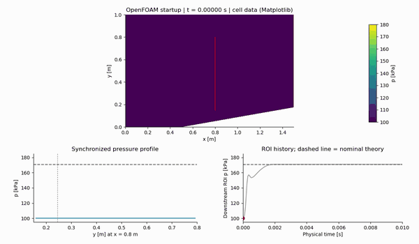
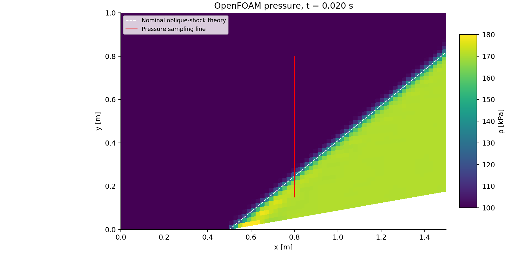
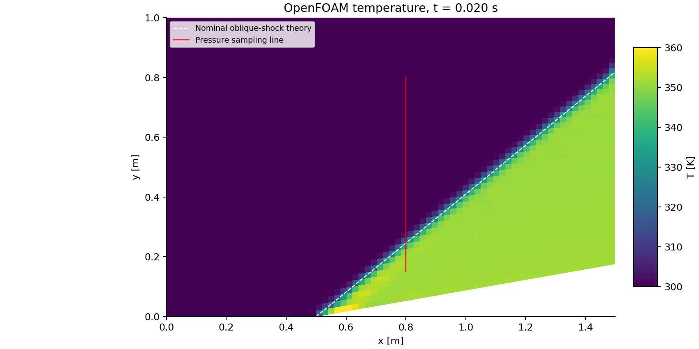
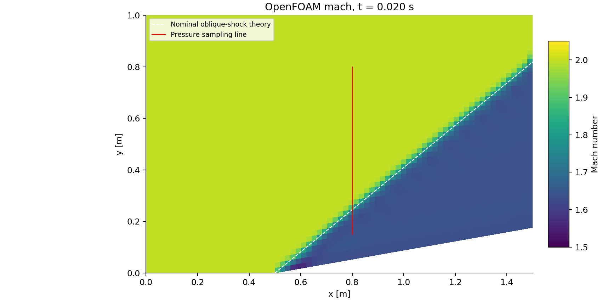
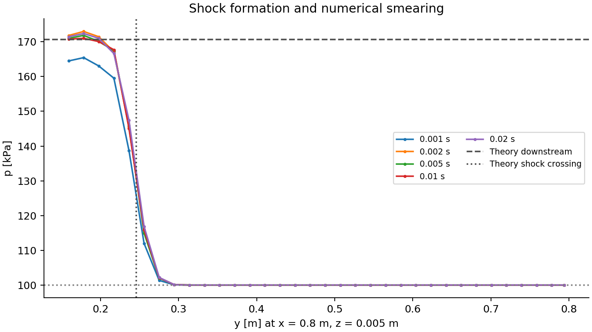
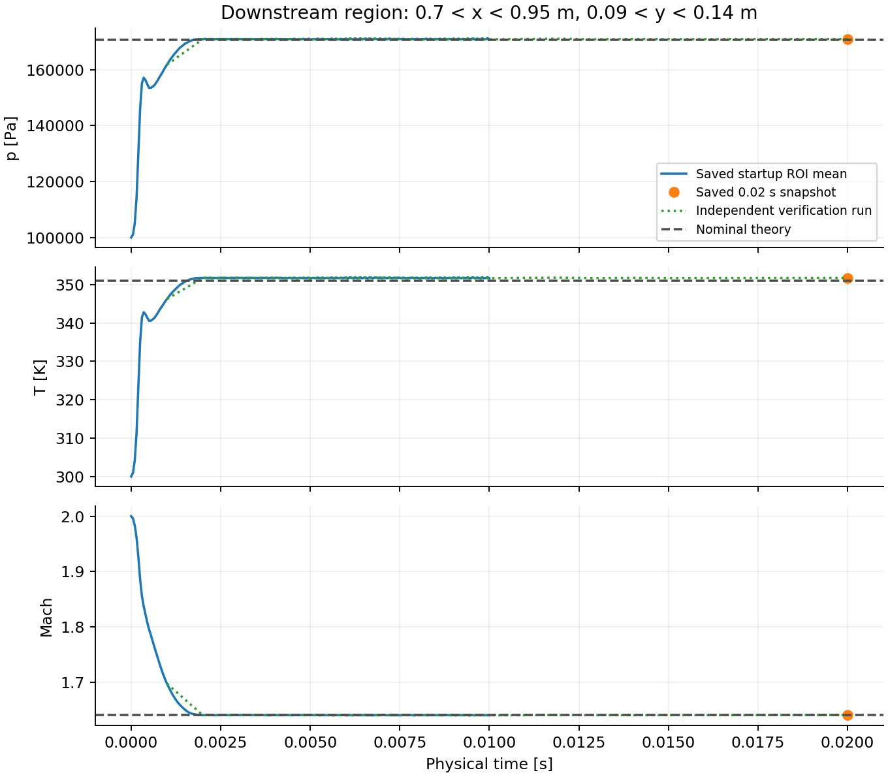

# Supersonic wedge flow — OpenFOAM recreation

An independent recreation of the physical case in SU2’s [Inviscid Supersonic Wedge tutorial](https://su2code.github.io/tutorials/Inviscid_Wedge/), using **OpenFOAM v1706**, `rhoCentralFoam`, and a newly constructed Gmsh mesh. Supersonic flow encounters a 10° compression ramp, turns toward the channel interior, and forms an attached oblique shock. Pressure and temperature rise across the shock; the downstream flow remains supersonic.

The tutorial credits **Thomas D. Economon (`@economon`)**, with revision by **Tim Albring (`@talbring`)**. Its [SU2 configuration](https://github.com/su2code/Tutorials/blob/master/compressible_flow/Inviscid_Wedge/inv_wedge_HLLC.cfg) attributes Economon’s work to **Stanford University**, dated 2012-10-07. This is the specific Stanford connection. This project is independently prepared and is not endorsed by Stanford University or SU2.

The algorithms differ: the referenced SU2 case uses HLLC, implicit Euler and multigrid; this case uses a Kurganov central-upwind flux and explicit Euler time stepping. Matching the physical setup does **not** establish identical discretization or cross-code validation. No numerical SU2 comparison dataset was supplied.

## Startup animation and interpretation

[Full-resolution startup video (WebM)](media/startup-plots.webm). All three panels follow the same physical time from **0 to 0.01 s**. The video has 201 frames at 20 fps, showing 0.01 s of flow over approximately 10 s of playback. The lightweight GIF uses 51 frames at 5 fps. The fixed pressure scale is **100–180 kPa**; the red line marks the sampling location, and the dashed horizontal plot reference is nominal downstream shock theory. The grey history curve provides the full startup context, with a red marker locating the displayed time.

These are actual saved OpenFOAM cell fields rendered with Matplotlib, using mesh face topology and OpenFOAM owner indices. ParaView 5.7 is installed, but its Python module is missing, so its batch export could not run. The alternative export was authorized. WebM/VP9 and GIF were generated and inspected; MP4 was unavailable because FFmpeg and a usable GStreamer MP4 video encoder are absent.

## Physical and numerical setup

| Item | Saved case / published baseline |
|---|---|
| Geometry | Length 1.5 m; upper wall y = 1 m; flat lower wall to x = 0.5 m |
| Ramp | Starts at (0.5, 0); 10°; outlet y = 0.176326980708465 m |
| Dimensionality | Planar 2D, z = 0–0.01 m, one cell through thickness; empty front/back |
| Initial and inlet state | U = (694.45, 0, 0) m/s; p = 100,000 Pa; T = 300 K |
| Gas | Perfect gas; molecular weight 28.965 kg/kmol; Cp = 1004.703 J/(kg K); Hf = 0 |
| Thermodynamics | hePsiThermo / pureMixture / const transport / hConst / perfectGas / sensibleInternalEnergy |
| Inviscid model | Dynamic viscosity mu = 0; Pr = 0.72; simulationType laminar |
| Solver / flux | rhoCentralFoam / Kurganov |
| Time / reconstruction | Euler; vanLeer for rho and T; vanLeerV for U |
| Adaptive stepping | Initial deltaT = 1e-7 s; maxDeltaT = 1e-5 s; maxCo target = 0.2 |
| Published baseline output | End time 0.02 s; adjustableRunTime output every 0.001 s |
| Saved startup output | End time 0.01 s; adjustableRunTime output every 0.00005 s |

Both channel boundaries are impermeable slip walls. Inlet U, p and T are fixed; the outlet uses zeroGradient for all three. Upper/lower U uses slip, with zeroGradient p and T. All fields use empty on frontAndBack. Mesh patches inlet/outlet are patch, upper/lower are wall, and frontAndBack is empty.

The SU2 configuration specifies inlet velocity **695.4290761824674 m/s**, despite the tutorial’s nominal Mach-2, 300 K description. The saved OpenFOAM inlet uses **694.45 m/s**, consistent with nominal Mach 2 for this gas. The effective R recovered from saved p/(rho T) is 287.052307 J/(kg K), giving gamma = 1.39998889 and inlet Mach = 2.00003474. This small source discrepancy is retained explicitly rather than hidden.

## Mesh

The editable [Gmsh geometry](geometry/su2Wedge.geo) contains the six original planar points, seven curves and two quadrilateral surfaces. Splitting at x = 0.5 m gives two four-corner transfinite blocks with compatible opposite-edge counts and a shared conformal curve. Explicit corner ordering, surface recombination, and joint extrusion with one recombined layer produce **3,626 hexahedra**: (25 + 49) × 49 × 1.

Curves 1/5 have 26 points; 2/4 and 6/7/3 have 50 points. Both surfaces are extruded together by (0, 0, 0.01). The exported [mesh](geometry/su2Wedge.msh) is ASCII MSH 2.2. These physical IDs were inspected in the actual OpenCASCADE `.geo` file:

| Physical group | Gmsh surfaces / volumes | OpenFOAM boundary faces |
|---|---|---:|
| inlet | Surface 6 | 49 |
| outlet | Surface 9 | 49 |
| lower | Surfaces 3, 10 | 74 |
| upper | Surfaces 5, 8 | 74 |
| frontAndBack | Surfaces 1, 2, 7, 11 | 7,252 |
| fluid | Volumes 1, 2 | — |

The shared internal dividing surface is excluded from external groups. The saved mesh and an independently regenerated Gmsh → gmshToFoam mesh both report **Mesh OK**. Their bounds are (0,0,0) to (1.5,1,0.01); maximum non-orthogonality is **9.89999°**, maximum skewness **0.21204**, and total volume **0.0141183651 m³**. Full check logs are included.

The importer emits an intermediate undefined-face warning before assigning physical groups. Its final boundary contains exactly the five expected patches and no unassigned default patch; the subsequent mesh check passes.

## Results and limits

| Quantity | Nominal Mach-2 theory | Saved 0.02 s measurement |
|---|---:|---:|
| Upstream pressure | 100,000 Pa | 100,000 Pa |
| Pressure ratio | 1.706579 | 1.710004 |
| Downstream pressure | 170,657.86 Pa | 171,000.36 Pa |
| Downstream temperature | 351.045 K | 351.748 K |
| Downstream Mach | 1.640522 | 1.640834 |
| Shock angle | 39.313932° | No fitted angle claimed |

Computed downstream values are area-weighted means over **32 cells** with centers at 0.7 < x < 0.95 m and 0.09 < y < 0.14 m, away from the wall and shock transition. The upstream mean uses 247 cells at 0.15 < x < 0.4 m, 0.3 < y < 0.7 m. Downstream pressure is 0.201% above nominal theory and temperature is 0.200% above it. Mach is calculated locally as |U|/sqrt(gamma R T), using the saved temperature and case thermodynamics.

The requested line from **(0.8, 0.15, 0.005) to (0.8, 0.8, 0.005)** crosses the shock. Profiles use intersected cell values; drawn connections between segment midpoints do not imply additional resolution. At 0.02 s, the 10–90% pressure-rise width is approximately **0.04848 m**, roughly 2.5 local cells. Its 50% crossing is y = **0.24417 m**, versus theoretical y = **0.24567 m**. This is a single-line location comparison, not a demonstrated shock-angle match. Threshold crossings are interpolated between sample midpoints. The coarse mesh visibly smears the shock.

The original directory contained 201 startup states through 0.01 s and a separate older 0.02 s snapshot. Its existing solver log covers only the startup run. These snapshots alone do not provide a continuous 0.01–0.02 s stationarity record.

An isolated baseline rerun to 0.02 s supplies that check. From 0.01 to 0.02 s, its area-weighted relative L1 pressure change is **0.0779%**; from 0.019 to 0.02 s it is **0.0325%**, with a maximum local change of **1.50 kPa**. The downstream plateau is stable, while local changes persist near the shock. The baseline rerun and original 0.02 s snapshot differ by **0.0271%** in unweighted relative L1 pressure, with maximum difference **1.19 kPa**. The changed write schedule also changes adaptive time-step alignment, so exact reproduction is not claimed. The original log’s maximum reported Courant number is **0.20891**, slightly above its 0.2 target.

Diagonal solver residuals printed as zero are not evidence of steady convergence. There is no mesh-independence study, fitted shock-angle validation, or numerical SU2 agreement claim.

## Repository contents and provenance

| Directory | Contents |
|---|---|
| `geometry/` | Editable Gmsh source and exported mesh |
| `case/` | Initial fields, thermophysical/numerical settings and verified OpenFOAM mesh |
| `analysis/`, `scripts/` | Extraction, plotting, isolated-case generation and video-export source |
| `results/` | Measurements, pressure profiles, histories, selected field arrays and verification comparisons |
| `media/` | Contours, interpretation plots, synchronized GIF and video |
| `logs/` | Mesh checks, import/export logs and compressed full solver logs |
| `provenance/`, `licenses/` | Preservation record, source evidence and third-party license text |

Before changes, all **1,228 original files** were archived locally with SHA-256 records; rechecking found no original file changes. The backup is kept outside this repository. All generated time directories, diagnostic sets, raw animation frames and large intermediate outputs are excluded from Git. The retained selected-field archive stores mesh polygons and p/T/Mach at 0.01 and 0.02 s; it is an analysis artifact, not a solver restart.

The original unused blockMeshDict and fvSchemes exactly match OpenFOAM v1706’s **compressible/rhoCentralFoam/wedge15Ma5** tutorial. This supports identifying that tutorial as the starting template; the copied blockMeshDict describes a different geometry and is excluded here. The working mesh is the Gmsh mesh inspected above.

SU2 tutorial text, figures, configuration and CGNS mesh are linked for attribution and are not redistributed. OpenFOAM-derived files retain their headers and applicable [GPL v3-or-later terms](licenses/OpenFOAM-GPL-3.0.txt). No new license is assigned to third-party material or implied for the project’s other content.
